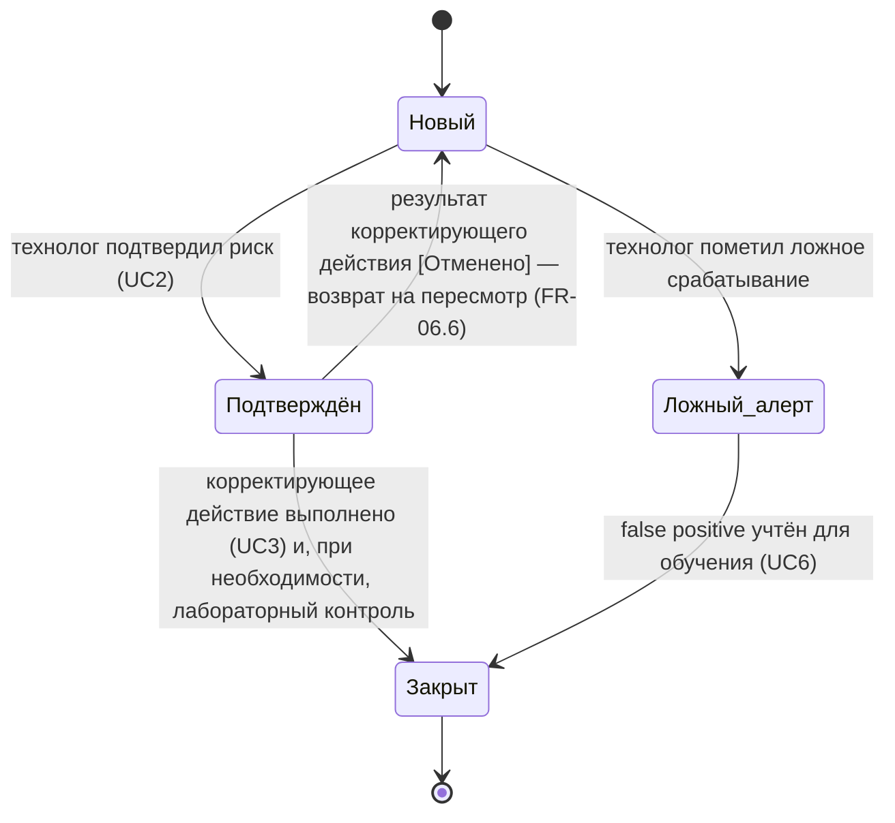
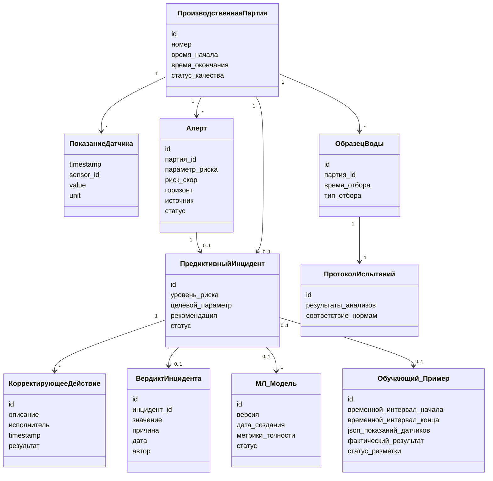

# AquaPredict LIMS — Модель предметной области (Domain Model / Conceptual Class Diagram)

Демонстрирует понимание структуры данных. Ключевые классы и связи.

## Классы и атрибуты

### ПроизводственнаяПартия
`id`, `номер`, `время_начала`, `время_окончания`, `статус_качества`

- *1 ко многим* → **ПоказаниеДатчика**
- *1 к 0..1* → **ПредиктивныйИнцидент**

### ПоказаниеДатчика
`timestamp`, `sensor_id`, `value`, `unit`

> Перечень параметров телеметрии (`sensor_id`) и целевых лабораторных показателей раскрыт в `requirements/measured_parameters.md` (TEL-01…TEL-13, LAB-01…LAB-16).

### Алерт
`id`, `партия_id`, `параметр_риска`, `риск_скор`, `горизонт`, `источник` [Слой 1 / Слой 2], `статус` [Новый / Ознакомлен / В работе / Закрыт / Подавлен]

- *1 к 0..1* → **ПредиктивныйИнцидент** (подавленный дубль инцидент не создаёт — решение В-6)
- Алерт — уведомление; инцидент — учётная запись с задачей (В-5).

### ПредиктивныйИнцидент
`id`, `уровень_риска`, `целевой_параметр`, `рекомендация`, `статус` [Новый / Подтверждён / Ложный_алерт / Закрыт]

- *1 ко многим* → **КорректирующееДействие**
- *связан с* **МЛ_Модель** (версия, сделавшая прогноз)
- *связан с* **Обучающий_Пример** (источник данных для будущего обучения)

### КорректирующееДействие
`id`, `описание`, `исполнитель`, `timestamp`, `результат` [Выполнено / Отменено]

> **Важно.** «Ложный_алерт» — это вердикт по **инциденту** (статус `ПредиктивныйИнцидент`), а не результат корректирующего действия. Корректирующее действие выполняется или отменяется; смешение этих сущностей недопустимо.

### ВердиктИнцидента
`id`, `инцидент_id`, `значение` [Подтверждён / Ложное_срабатывание], `причина` (из справочника), `дата`, `автор`

- *связан с* **ПредиктивныйИнцидент** (1 к 0..1)
- Вердикт — отдельная **аудируемая запись** (решение В-1); причина нужна для карантина конфликтов (FR-11.2) и анализа FPR. Статус инцидента хранится в базовой сущности.

> Соответствие терминов: значение статуса `Ложный_алерт` (код) отображается пользователю как «Ложное срабатывание» (термин глоссария, решение В-4).

### ОбразецВоды
`id`, `партия_id`, `время_отбора`, `тип_отбора` [Плановый / Внеплановый_по_алерту]

- *1 к 1* → **ПротоколИспытаний**

### ПротоколИспытаний
`id`, `результаты_анализов`, `соответствие_нормам`

### МЛ_Модель
`id`, `версия`, `дата_создания`, `метрики_точности`, `статус` [В_обучении, Тестовая, Продакшн, Архив]

### Обучающий_Пример
`id`, `временной_интервал_начала`, `временной_интервал_конца`, `json_показаний_датчиков`, `фактический_результат` [число или категория], `статус_разметки` [Автоматически, Проверено_DS, Конфликт]

> Статус «Конфликт» — примеры, где вердикт технолога противоречит объективным данным; помещаются в карантин и не участвуют в обучении до разрешения Data Scientist-ом (см. `04_use_cases.md`, UC6 поток 6б; `08_data_requirements.md`).

## Ключевая особенность модели

Обратите внимание на связь **ОбразецВоды** и **ПредиктивныйИнцидент**. Система не просто ждёт планового отбора: она инициирует внеплановый отбор пробы именно в момент срабатывания алерта, чтобы лабораторно подтвердить или опровергнуть прогноз ML.

## Модель состояний предиктивного инцидента

## Диаграмма классов

