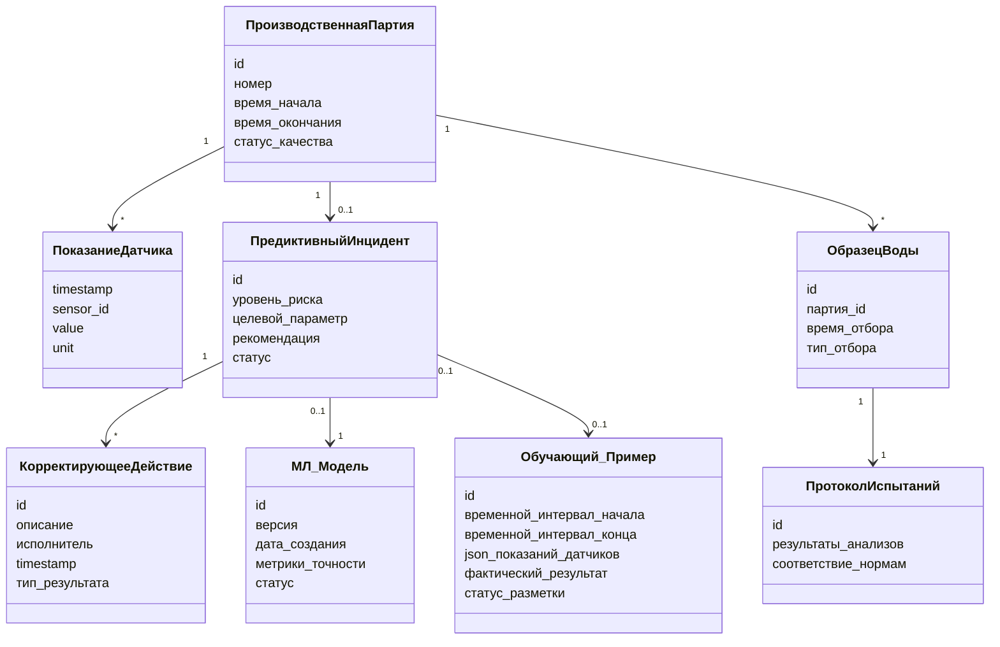

# AquaPredict LIMS — Модель предметной области (Domain Model / Conceptual Class Diagram)

Демонстрирует понимание структуры данных. Ключевые классы и связи.

## Классы и атрибуты

### ПроизводственнаяПартия
`id`, `номер`, `время_начала`, `время_окончания`, `статус_качества`

- *1 ко многим* → **ПоказаниеДатчика**
- *1 к 0..1* → **ПредиктивныйИнцидент**

### ПоказаниеДатчика
`timestamp`, `sensor_id`, `value`, `unit`

### ПредиктивныйИнцидент
`id`, `уровень_риска`, `целевой_параметр`, `рекомендация`, `статус`

- *1 ко многим* → **КорректирующееДействие**
- *связан с* **МЛ_Модель** (версия, сделавшая прогноз)
- *связан с* **Обучающий_Пример** (источник данных для будущего обучения)

### КорректирующееДействие
`id`, `описание`, `исполнитель`, `timestamp`, `тип_результата` [Успех / Ложный_алерт]

### ОбразецВоды
`id`, `партия_id`, `время_отбора`, `тип_отбора` [Плановый / Внеплановый_по_алерту]

- *1 к 1* → **ПротоколИспытаний**

### ПротоколИспытаний
`id`, `результаты_анализов`, `соответствие_нормам`

### МЛ_Модель
`id`, `версия`, `дата_создания`, `метрики_точности`, `статус` [В_обучении, Тестовая, Продакшн, Архив]

### Обучающий_Пример
`id`, `временной_интервал_начала`, `временной_интервал_конца`, `json_показаний_датчиков`, `фактический_результат` [число или категория], `статус_разметки` [Автоматически, Проверено_DS]

## Ключевая особенность модели

Обратите внимание на связь **ОбразецВоды** и **ПредиктивныйИнцидент**. Система не просто ждёт планового отбора: она инициирует внеплановый отбор пробы именно в момент срабатывания алерта, чтобы лабораторно подтвердить или опровергнуть прогноз ML.

## Диаграмма классов

