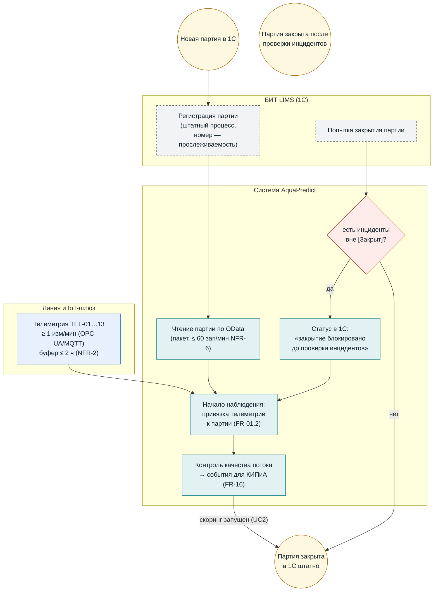

# BPMN (визуальная версия) — UC1: Синхронизация партии

**Версия:** 1.0 (визуализация `bpmn_uc1_party_telemetry.md`; канонические BPMN 2.0/SVG — `diagrams/bpmn/uc1.*`). Термины — `02_glossary.md`.

## Инварианты

- Партии создаёт и закрывает только 1С (вариант A); система записывает лишь статус/комментарий блокировки (FR-15.2).
- Данные буфера досинхронизируются в исходном порядке без дублей (FR-01.3).
