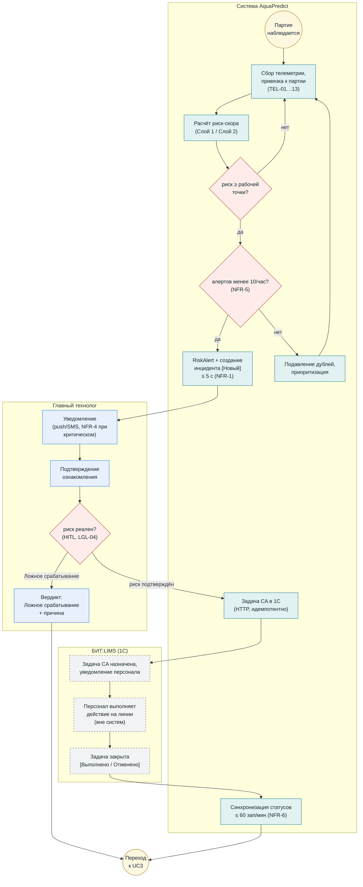

# BPMN (визуальная версия) — UC2: Предиктивное предупреждение

**Версия:** 1.1. Визуальная (mermaid) схема процесса `bpmn_uc2_prediction_alert.md` — для быстрого просмотра в GitHub. Канонический BPMN: `bpmn/uc2.bpmn` (BPMN 2.0) · SVG: `bpmn/uc2.svg`.
Легенда: ⭕ события · ▭ задачи · ◇ шлюзы. Дорожки — рамки. Термины — `02_glossary.md`.

## Инварианты (не видны на диаграмме, обязательны)

- Команд в ПЛК/SCADA нет (NFR-7); запись — только задачи/статусы в 1С.
- Вердикт — отдельная сущность `ВердиктИнцидента` (решение В-1); результат CA [Выполнено/Отменено] ≠ вердикт.
- Закрытие партии блокировано до перевода инцидента в [Закрыт] (FR-01.4).
- Основание решения о качестве — лабораторный контроль (LGL-11); текстовая версия с полными ссылками — `bpmn_uc2_prediction_alert.md`.
