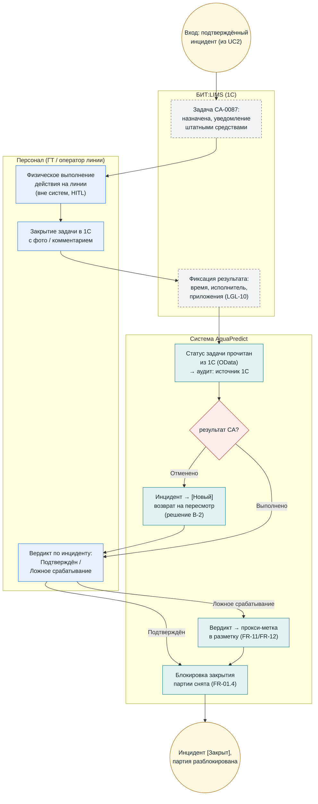

# BPMN (визуальная версия) — UC3: Корректирующее действие

**Версия:** 1.1. Визуальная (mermaid) схема процесса `bpmn_uc3_corrective_action.md`. Канонический BPMN: `bpmn/uc3.bpmn` · SVG: `bpmn/uc3.svg`; термины — `02_glossary.md`.

## Инварианты

- Результат CA [Выполнено / Отменено] ≠ вердикт по инциденту (FR-06.5) — разные сущности.
- Пока инцидент вне [Закрыт] — закрытие партии блокировано (FR-01.4).
- Аудит различает «рекомендация системы / решение человека / фактическое действие» (LGL-10).
