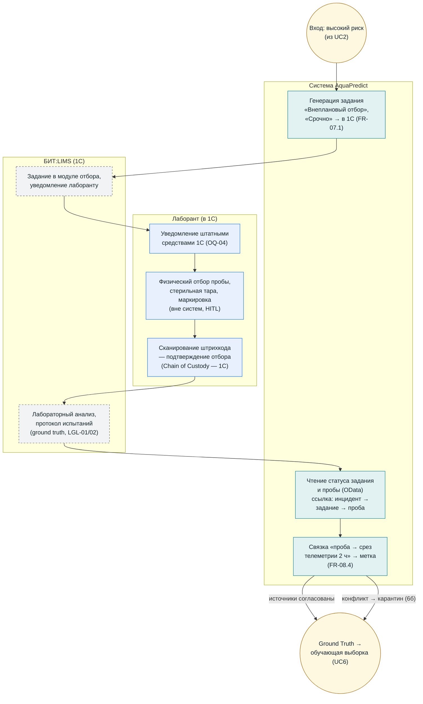

# BPMN (визуальная версия) — UC4: Внеплановый отбор пробы

**Версия:** 1.0 (визуализация `bpmn_uc4_trigger_sampling.md` стандартным mermaid). Термины — `02_glossary.md`.

## Инварианты

- Двойной ввод исключён: журнал проб — только 1С (FR-08.2, вариант A).
- Приоритет метки: лабораторный протокол > вердикт технолога (FR-11.1); конфликт → карантин (FR-11.2).
- True Positive / False Positive фиксируются автоматически из связки «прогноз → факт» (UC6).
