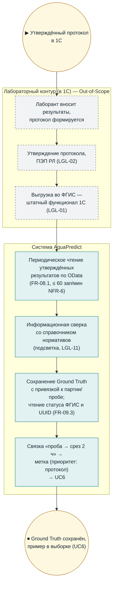

# BPMN (визуальная версия) — UC5: Получение Ground Truth

**Версия:** 1.0 (визуализация `bpmn_uc5_ground_truth.md`; канонические BPMN 2.0/SVG — `diagrams/bpmn/uc5.*`). Термины — `02_glossary.md`.

## Инварианты

- AquaPredict не формирует, не подписывает и не выгружает протоколы (LGL-01/02/07 в редакции ведущего); неподписанные протоколы не отображаются как «отправляемые» (SCR-05).
- Сверка с нормативами — информационная; решение о несоответствии — в 1С (LGL-11).
