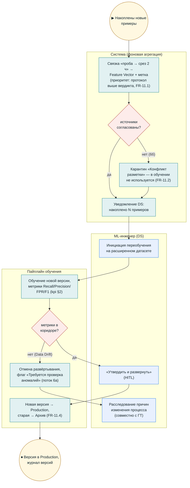

# BPMN (визуальная версия) — UC6: Переобучение модели

**Версия:** 1.0 (визуализация `bpmn_uc6_retraining.md`; канонические BPMN 2.0/SVG — `diagrams/bpmn/uc6.*`). Термины — `02_glossary.md`.

## Инварианты

- Мониторинг дрейфа — непрерывно, не только при переобучении (LGL-13, FR-11.6); деградация → SCR-06 и уведомления DS/ГТ.
- Приоритет метки: лабораторный протокол выше вердикта технолога; конфликты — в карантин (FR-11.2).
- Все решения DS — в аудите с различением источников (LGL-10).
