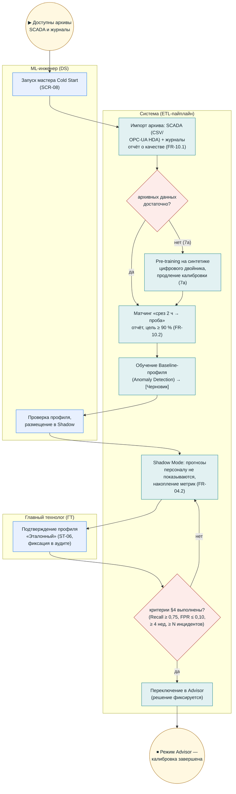

# BPMN (визуальная версия) — UC7: Cold Start

**Версия:** 1.0 (визуализация `bpmn_uc7_cold_start.md`; канонические BPMN 2.0/SVG — `diagrams/bpmn/uc7.*`). Термины — `02_glossary.md`.

## Инварианты

- Слой 1 (правила) стартует независимо от Cold Start; Слой 2 — по критериям перехода (`10_cold_start_and_archival_data.md` §4, `kpi.md` §6).
- Матчинг архива — тот же механизм, что и связка в текущей работе (FR-08.4).
- Доля успешного матчинга ≥ 90 % — системный KPI (`kpi.md` §4).
