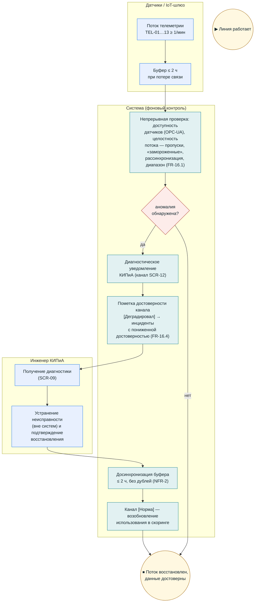

# BPMN (визуальная версия) — UC8: Мониторинг источников телеметрии

**Версия:** 1.0 (визуализация `bpmn_uc8_telemetry_monitoring.md`; канонические BPMN 2.0/SVG — `diagrams/bpmn/uc8.*`). Термины — `02_glossary.md`.

## Инварианты

- Достоверность телеметрии — условие корректности прогноза: FR-03/FR-04 потребляют только достоверные данные.
- Диагностические события КИПиА — отдельный канал; бюджет предиктивных алертов (NFR-5) не расходуют.
- Рассинхронизация времени — основание для пометки недостоверности (FR-02.6).
