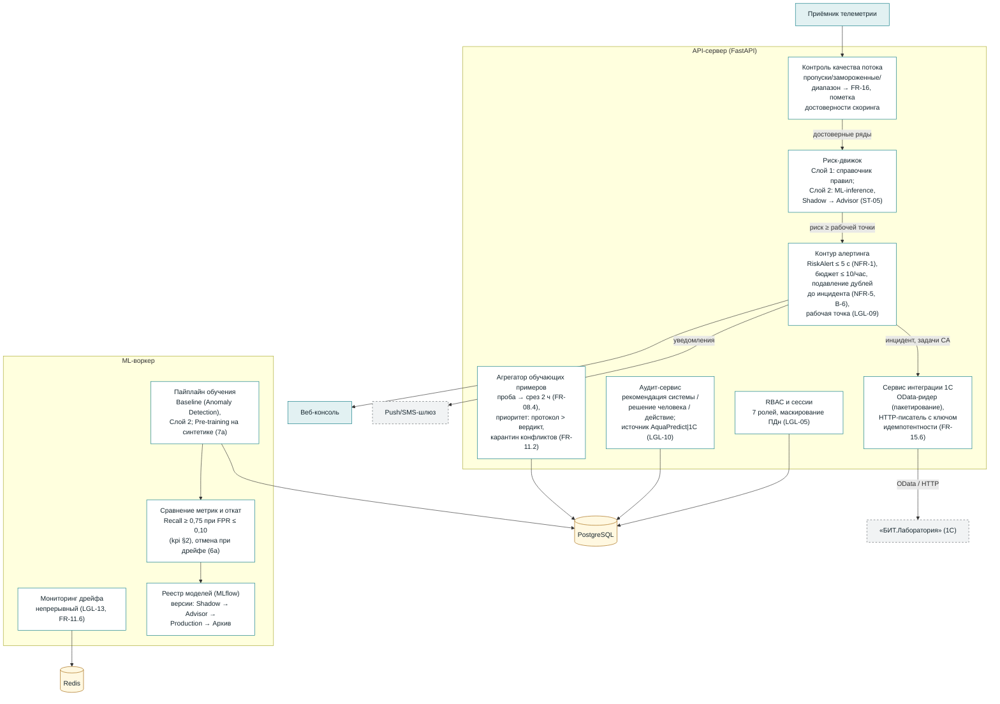

# C4-3. Диаграмма компонентов (Components: API-сервер и ML-воркер)

**Версия:** 1.0. Раскрыты два самых нагруженных контейнера; состав компонентов — из FR v1.1 (блоки → модули). Обозначения как на C4-2.

## Связь с документами

- Компоненты ↔ FR: алертинг — FR-05; движок — FR-03/04; интеграция — FR-15; контроль потока — FR-02.4/FR-16; агрегатор — FR-08.4/FR-11; аудит — FR-14.3; пайплайн — FR-10/FR-11.
- Компоненты ↔ BPMN: шаги UC2/UC3 (alerting → sync → 1С), UC6 (TRAIN/EVAL/DRIFT), UC7 (TRAIN), UC8 (QUAL).
- Состав раскрыт до уровня, достаточного для оценки задач R0–R2 (`plans/backlog_implementation_plan.md`); детализация до «Code»-уровня — в зоне backend при реализации.
