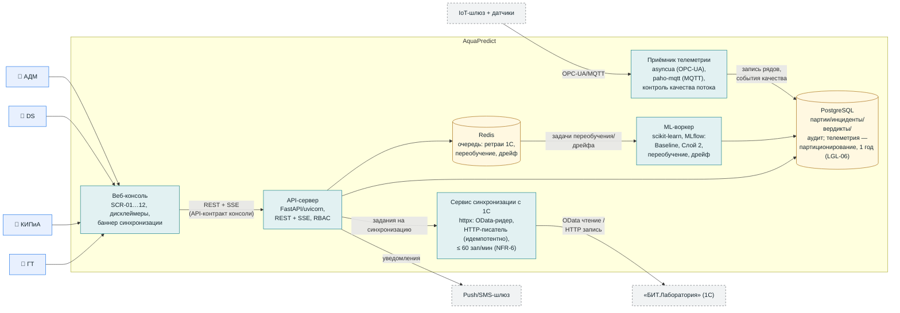

# C4-2. Диаграмма контейнеров (Containers)

**Версия:** 1.0. Технологии — утверждённый стек `architecture_stack.md`; состав — FR v1.1. Обозначения: голубой — персона, зелёный контур — контейнеры AquaPredict, серый пунктир — внешние.

## Примечания

- **Пуш/SMS-шлюз** — внешний сервис доставки (SCR-12); лаборанту уведомления идут средствами 1С (OQ-04).
- **IoT-шлюз** — оборудование, поставляемое Исполнителем (Приложение № 3); буферизация ≥ 2 ч (NFR-2), NTP.
- Деградация 1С не блокирует приём телеметрии и скоринг — очередь в Redis персистентна (FR-15.5).
- Выбор фронтенд-технологии консоли — OQ-12 (решение ведущего); на диаграмме контейнер не зависит от этого решения.
