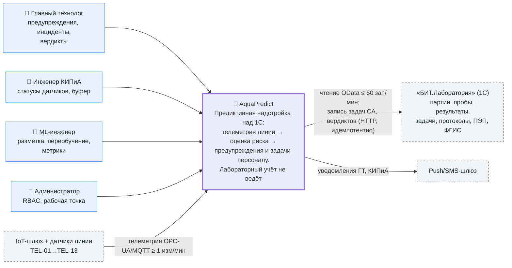

# C4-1. Диаграмма контекста (System Context)

**Версия:** 1.0 (задание ведущего: уровни C4-1…C4-3 в mermaid, стандартный `flowchart` — без специального типа C4). Условные обозначения: голубой прямоугольник — персона, зелёный — система AquaPredict, серый пунктир — внешние системы/оборудование. Термины — `02_glossary.md`; границы — вариант A (`01_vision_and_scope.md`).

## За границей контекста (в контуре 1С заказчика)

- **Лаборант и оператор линии** — работают в «1С» (задачи корректирующих действий и отбора приходят туда; OQ-03/04).
- **Протоколы испытаний, ПЭП руководителя лаборатории, выгрузка во ФГИС Росаккредитации, маркировка «Честный ЗНАК»** — штатный контур 1С (LGL-01/02/07, OQ-11); AquaPredict читает статусы выгрузки (FR-09.3).
- **SCADA/ПЛК** — AquaPredict не отправляет управляющих команд (NFR-7); шлюз только читает показания.

## Роли, показанные в 1С-контуре

Диаграмма отражает роли веб-консоли по RBAC-матрице (`ui_requirements.md` §3); ЛБ/ОЛ в консоли не работают (OQ-03/04).
