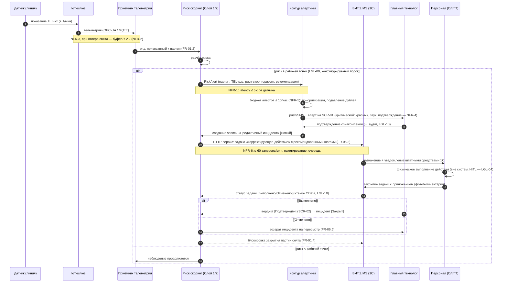

# Sequence v1 — UC2 → UC3: от показания датчика до закрытия корректирующего действия

**Версия:** 0.1 (C-05). Основной демонстрационный поток; показывает границы системы, интеграцию с 1С и точки применения NFR/LGL. Термины — `02_glossary.md`; процессы — BPMN UC2/UC3.

## Границы и гарантии

- Управляющих команд в ПЛК/SCADA нет (NFR-7) — запись в 1С только задач/статусов.
- Вердикт ГТ — прокси-метка; основание решения о качестве — лабораторный контроль (LGL-11).
- Все шаги с участием человека фиксируются в аудите с различением «рекомендация системы / решение человека / фактическое действие» (LGL-10, FR-14.3).
- Параллельная ветка: при подтверждённом риске — задание внепланового отбора (sequence UC4).
