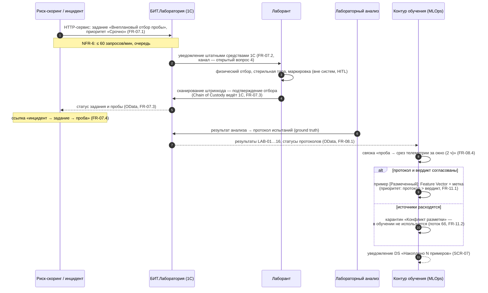

# Sequence v1 — UC4: внеплановый отбор и формирование «золотого стандарта» данных

**Версия:** 0.1 (C-05). Показывает замыкание контура UC2 → UC4 → UC5 → UC6: алерт превращается в размеченный пример. Термины — `02_glossary.md`; процессы — BPMN UC4.

## Замечания

- AquaPredict не ведёт журнал проб — всё чтение из 1С (вариант A, FR-08.2).
- True Positive / False Positive фиксируются автоматически из связки «прогноз → факт» (UC6, раздел «золотой стандарт»).
- Диаграмма — источник требований к приёму OData-выгрузки и к справочнику приоритетов меток (FR-11.1).
