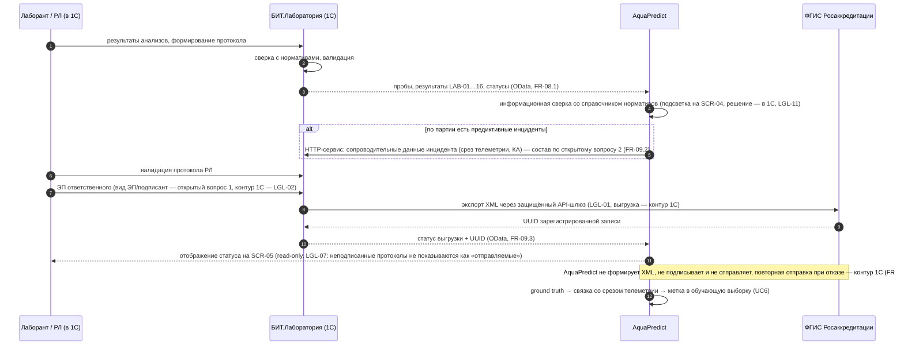

# Sequence v1 — UC5 (вариант A): протокол, сопроводительные данные и статус ФГИС-выгрузки

**Версия:** 0.1 (C-05). Показывает границу варианта A: валидация, ЭП и выгрузка — в контуре 1С; AquaPredict передаёт сопроводительные данные и читает статусы. Термины — `02_glossary.md`; процесс — BPMN UC5 (вариант A).

## Замечания

- Диаграмма фиксирует границу ответственности, сняв противоречие G-1 ревью (Vision ↔ ASM-09); переформулировка LGL-01 — ожидается запись ведущего в `change_log.md`.
- Доработки 1С (XML-экспорт, ЭП) — вне проекта (`legal/…` §F, ASM-09).
