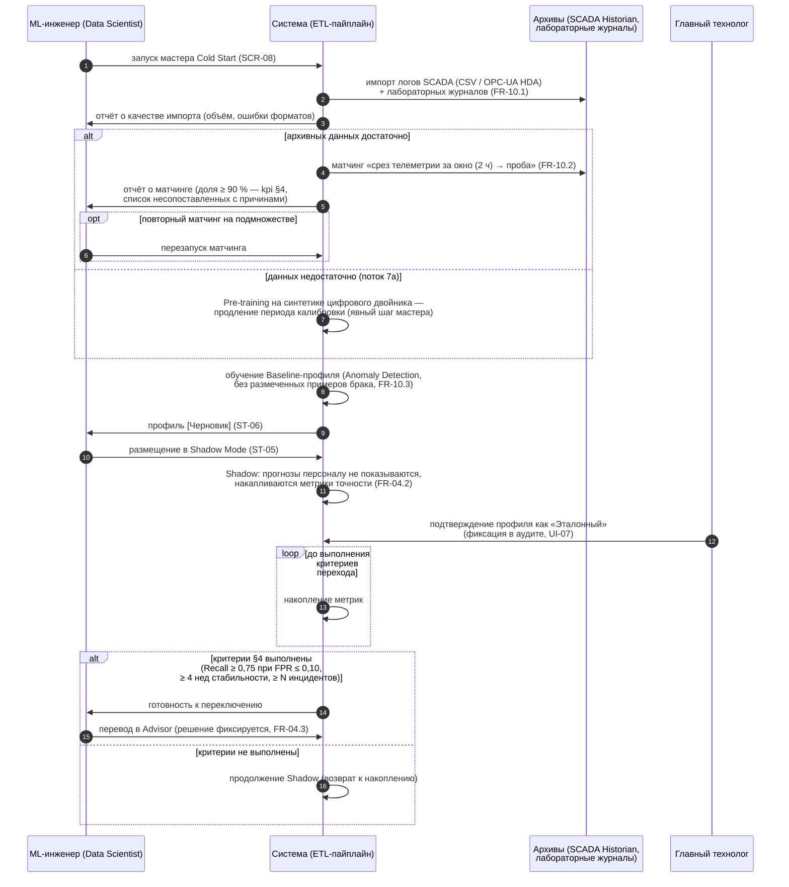

# Sequence v1 — UC7: первичная калибровка (Cold Start)

**Версия:** 0.1 (C-05, дополнение). Показывает конвейер от импорта архива до переключения в Advisor, включая поток 7а (недостаток данных). Термины — `02_glossary.md`; процесс — BPMN UC7 (`bpmn_uc7_cold_start.md`); состояния — ST-06/ST-05.

## Замечания

- Baseline-профиль и Shadow Mode — вход для FR-03/FR-04 (Слой 1 стартует сразу, Слой 2 — по критериям; «Фаза движка» vs «Фаза внедрения» — В-4).
- Матчинг архива использует тот же механизм, что и связка в текущей работе (FR-08.4, UC4).
