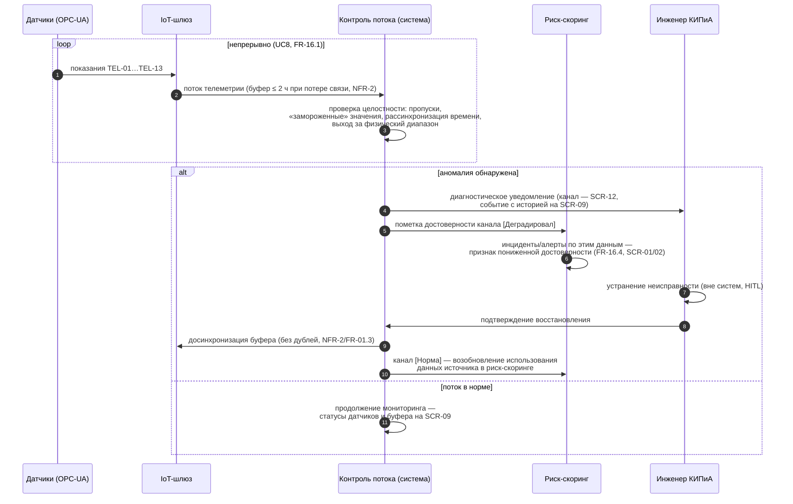

# Sequence v1 — UC8: мониторинг источников телеметрии (КИПиА)

**Версия:** 0.1 (C-05, дополнение). Показывает цикл «аномалия → диагностика → восстановление → возврат достоверности данных в скоринг». Термины — `02_glossary.md`; процесс — BPMN UC8 (`bpmn_uc8_telemetry_monitoring.md`); состояния — FR-16.

## Замечания

- Достоверность телеметрии — условие корректности прогноза: FR-03/FR-04 потребляют только достоверные данные (связь UC8 ↔ UC2).
- Уведомление КИПиА не расходует бюджет алертов линии (NFR-5 — бюджет для предиктивных алертов; диагностические события — отдельный канал; уточнить в C-08 при ревью).
