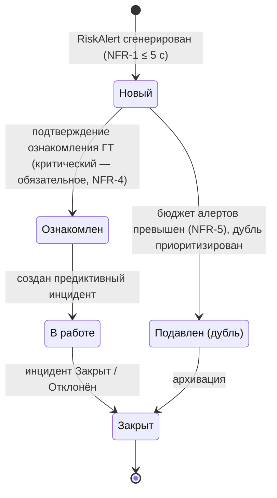
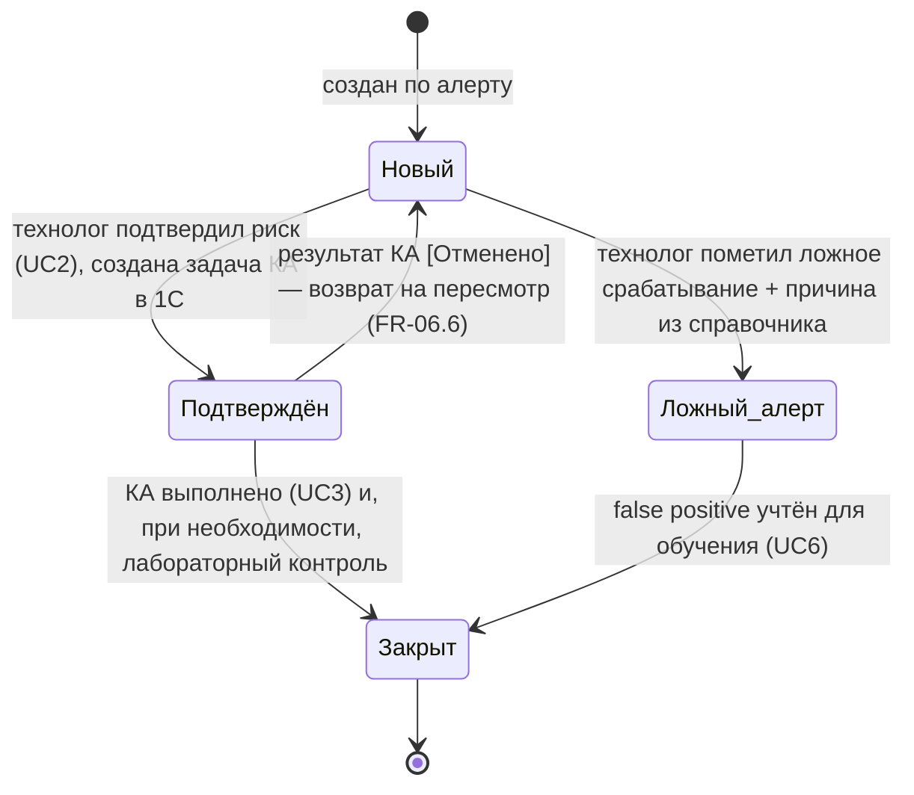
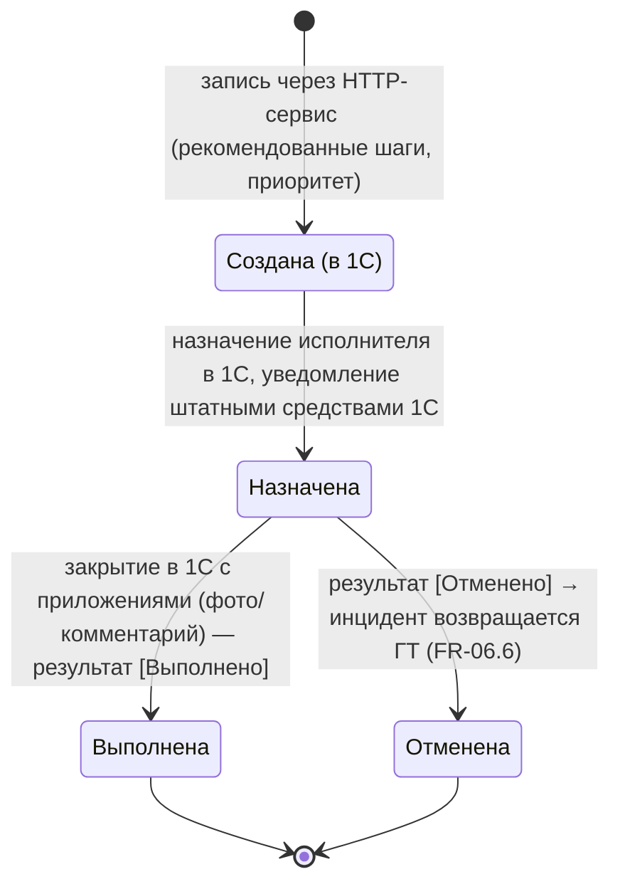
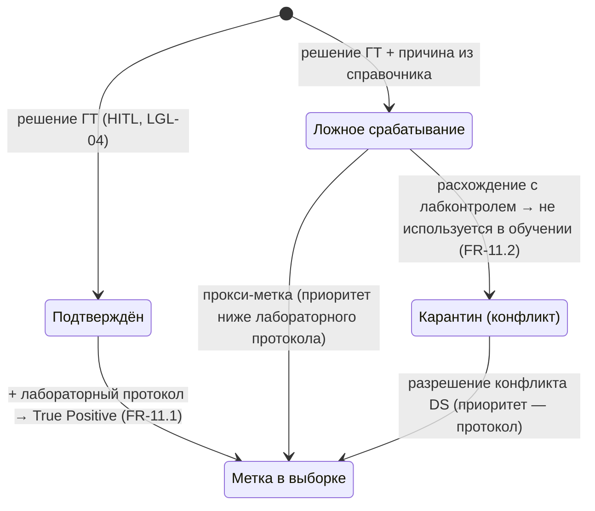

# State v1 — Алерт, предиктивный инцидент, задача, вердикт

**Версия:** 0.1 (C-05). **Независимо от вилки A/B** (вопрос вилки закрыт — вариант A).
Формализация состояний ST-01…ST-04 из `requirements/ui_requirements.md` §6. Термины — `02_glossary.md`; источники — FR-05, FR-06, FR-07, FR-12.

## 1. Алерт (ST-01, FR-05)

Инварианты: каждое подтверждение ознакомления фиксируется в аудите (кто/когда, LGL-10); признак источника [Слой 1 / Слой 2] не меняется.

## 2. Предиктивный инцидент (ST-02, FR-06)

Статусы — по доменной модели ведущего (`06_domain_model.md`, правка от 2026-10-12): [Новый / Подтверждён / Ложный_алерт / Закрыт].

Инварианты: пока инцидент не в [Закрыт] — закрытие партии в 1С блокировано (FR-01.4); переход в терминальный статус требует вердикта (ST-04 обязателен); статус «Ложный_алерт» относится к инциденту, а результат КА [Выполнено / Отменено] — к задаче (устранение дефекта US-05.1); вердикт уходит в разметку как прокси-метка (FR-12).

## 3. Задача КА / задание отбора (ST-03, FR-06.3/06.4, FR-07)

Инварианты: статусы синхронизируются из 1С (система — читатель, UI-06); время выполнения и исполнитель фиксируются в 1С (LGL-10); ошибка синхронизации → ST-07 [Ошибка], список замораживается (UI-SCR-03.5).

## 4. Вердикт по инциденту (ST-04, FR-06.5, FR-12)

Инварианты: вердикт ≠ результат КА (сущности раздельны, устранение дефекта US-05.1); вердикт обязателен перед терминальным статусом инцидента.
