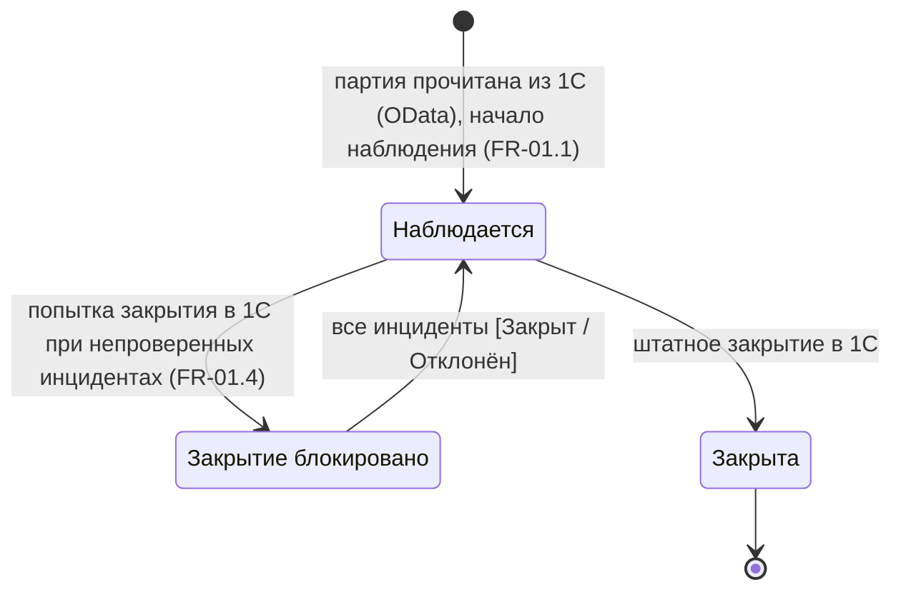
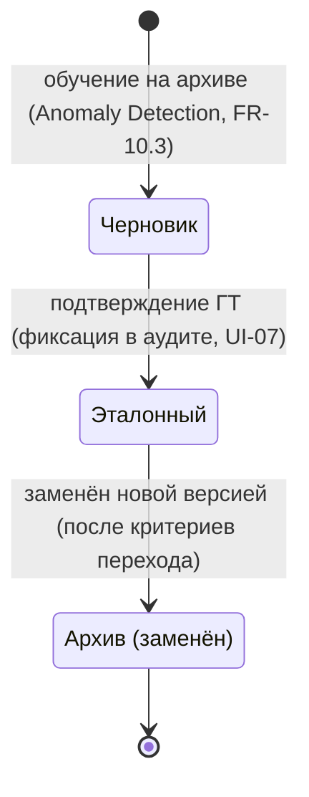
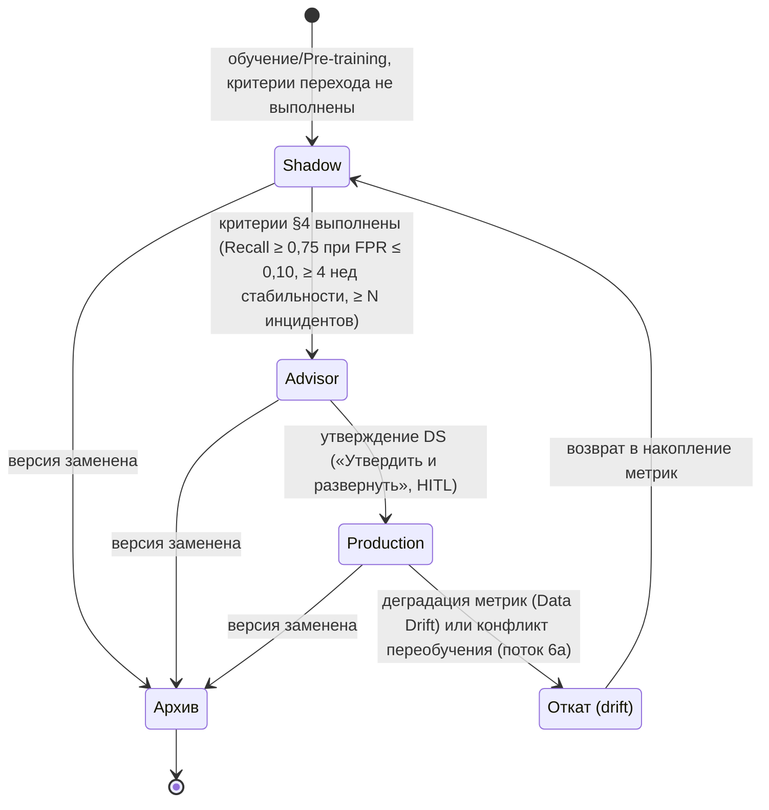
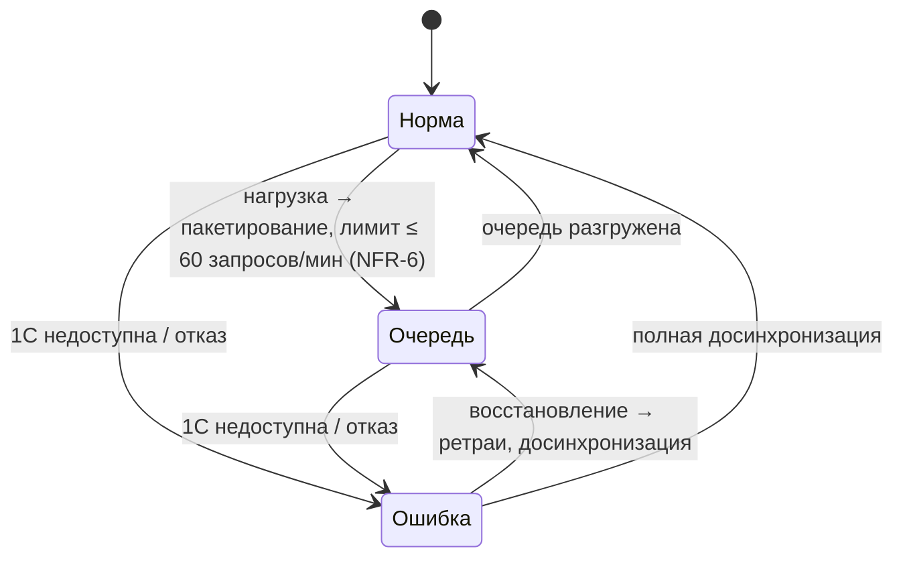

# State v1 — Партия, Baseline-профиль, ML-модель, синхронизация с 1С

**Версия:** 0.1 (C-05). Формализация состояний ST-05…ST-07 и состояния партии (FR-01). Термины — `02_glossary.md`.

## 1. Партия (FR-01)

Инварианты: партия создаётся/закрывается только в 1С (вариант A); система лишь записывает статус/комментарий блокировки (FR-15.2).

## 2. Baseline-профиль (ST-06, FR-10)

Инварианты: до [Эталонный] Shadow-метрики накапливаются, но персоналу не показываются (FR-04.2).

## 3. ML-модель (ST-05, FR-04, FR-11)

Инварианты: перевод Shadow → Advisor — по утверждённым критериям, решение фиксируется; в Shadow прогнозы персоналу не показываются; журнал версий ведётся (FR-11.4); мониторинг дрейфа непрерывен (LGL-13, FR-11.6).

## 4. Синхронизация с 1С (ST-07, FR-15)

Инварианты: приём телеметрии и скоринг при [Ошибка] продолжаются (FR-15.5); записи задач/статусов буферизуются; UI показывает время последней успешной синхронизации (UI-08).
