# AquaPredict — детальный план реализации бэклога (Backlog Implementation Plan)

План переводит продуктовый бэклог (`../backlog/product_backlog.md`, 14 эпиков, US-01.1…US-14.1) в последовательность релизов, работ и ворот. Опирается на FR v1.1 (`../requirements/functional_requirements.md`), UI v0.3 (`../requirements/ui_requirements.md`), BPMN/sequence/state (`../diagrams/`), NFR (`../07_nonfunctional_requirements.md`), KPI (`../kpi.md`), параметры (`../requirements/measured_parameters.md`), стоимость (`../cost/cost_estimation.md`). Архитектура — вариант A (надстройка над «БИТ.Лаборатория»).

## 0. Рамки и базовые решения

- Охват: EPIC-01…EPIC-14, User Stories US-01.1…US-14.1.
- **Бюджет — фазовое финансирование** (решение заказчика 2026-10-13): MVP первой очереди (Слой 1 + Cold Start); решение о Слое 2 — по критериям перехода (`../10_cold_start_and_archival_data.md`, §4).
- Команда и ставки — `../cost/cost_estimation.md` §3 (2 аналитика, backend, ML, frontend, DevOps, QA, интегратор 1С, юрист).
- Спринт — 2 недели; релизы R0…R3 (см. §2).

## 1. Принципы реализации

- **MVP = Слой 1 + Cold Start:** EPIC-01, EPIC-02, EPIC-03, EPIC-04, EPIC-05, EPIC-06, EPIC-07, EPIC-08 + базовые EPIC-12/13/14.
- Каждое US проходит **DoR → реализация → тесты → DoD**; вход — FR-xx.y + SCR-xx + BPMN/state + AC.
- Ветки `feat/<epic>`, PR с ревью ведущего; изменение базиса 01–10 — только с записью в `../change_log.md`.
- Термины — строго по `../02_glossary.md`; guardrails (NFR-5/6) обязательны на всех этапах.
- **Валидация ПО** по ГОСТ ISO/IEC 17025-2019 и соответствие LGL — сквозной трек (EPIC-12).

## 2. Релизы и состав

| Релиз | Цель | Эпики / US | Ворота | Стоимость (₽) |
| --- | --- | --- | --- | --- |
| **R0. Фундамент** | Интеграционное ядро и телеметрия | EPIC-01, EPIC-02, каркас EPIC-12/13 | — | ≈ 1 810 000 |
| **R1. MVP (Слой 1 + Cold Start)** | Правила, алерты, корректирующие действия, отбор, ETL/Baseline | EPIC-03, EPIC-04, EPIC-05, EPIC-06, EPIC-07, EPIC-08, EPIC-14, EPIC-12 (полн.), EPIC-13 (осн.) | Gate 3 | ≈ 3 640 000 |
| **R2. ML / Advisor** | Слой 2, MLOps, метрики, переход Shadow→Advisor | EPIC-09, EPIC-10, EPIC-11, FR-12 | — | ≈ 1 700 000 |
| **R3. Active / Full** | Дрейф, guardrails, масштаб, полировка | доработки, Фаза 3 | Gate 4 | — (цикл) |

Итого CAPEX (R0–R2) ≈ 7,15 млн ₽; с резервом 20 % ≈ 8,5 млн ₽ (`../cost/` §8).

## 3. Детальная разбивка по эпикам

Для каждого эпика: цели → задачи → зависимости → оценка → DoD → риски. Часы/₽ — из `../cost/cost_estimation.md` §4.

### EPIC-01 — Интеграция с «БИТ.Лаборатория» (300 ч, 650 000 ₽) · US-01.1 · FR-01, FR-15 · SCR-01

- **Задачи:**
  - T-01.1 OData-клиент чтения (партии, пробы, результаты LAB-01…16, статусы протоколов/ФГИС)
  - T-01.2 HTTP-клиент записи (задачи, рекомендации, вердикты, статусы блокировки партии)
  - T-01.3 очередь/rate-limit ≤ 60 req/min, ретраи с экспоненциальной задержкой
  - T-01.4 маппинг сущностей 1С↔AquaPredict и версионирование контракта
  - T-01.5 контрактные и интеграционные тесты на стенде 1С
- **Зависимости:** — (стартовый).
- **DoD (US-01.1):** чтение по OData работает; ≤ 60 req/min соблюдается; контракт версионируется; контрактные тесты зелёные.
- **Риски:** «зоопарк» сущностей 1С; настройка endpoints на стороне администратора 1С (FR-15.4).

### EPIC-02 — Сбор телеметрии и привязка к партии (360 ч, 800 000 ₽) · US-02.1 · FR-02 · SCR-01/09

- **Задачи:**
  - T-02.1 приёмник OPC-UA/MQTT (TEL-01…13, ≥ 1/мин)
  - T-02.2 буфер шлюза до 2 ч + автосинхронизация в исходном порядке (NFR-2)
  - T-02.3 привязка рядов к партии без дублей
  - T-02.4 time-series хранилище (retention 1 год, LGL-06)
  - T-02.5 latency ≤ 5 с (NFR-1)
  - T-02.6 контроль качества потока (пропуски/«заморозка»/диапазон) с хуком в EPIC-14
- **Зависимости:** EPIC-01.
- **DoD (US-02.1):** частота ≥ 1/мин; буферизация и досинхронизация; привязка без дублей; latency ≤ 5 с.
- **Риски:** доступ/адресация OPC-UA; рассинхронизация времени.

### EPIC-03 — Движок риск-скоринга, Слой 1 (180 ч, 400 000 ₽) · US-03.1 · FR-03 · BPMN uc2

- **Задачи:**
  - T-03.1 справочник правил (условие, TEL-код, порог, действие) + CRUD администратора с аудитом (LGL-03)
  - T-03.2 расчёт риска по правилам
  - T-03.3 признак источника «Слой 1»
  - T-03.4 старт без размеченных данных (Recall не нормируется; акцент Precision/FPR — `../kpi.md` §2)
- **Зависимости:** EPIC-02.
- **DoD (US-03.1):** правила настраиваются; риск-скор формируется с источником «Слой 1».
- **Риски:** подбор стартовой комплектации правил (гипотеза, уточняется ML-инженером).

### EPIC-04 — Предиктивные алерты и уведомления (230 ч, 500 000 ₽) · US-04.1 · FR-05 · SCR-01/12 · state ST-01

- **Задачи:**
  - T-04.1 генерация `RiskAlert` (партия, TEL-код, риск-скор, горизонт, рекомендация, источник)
  - T-04.2 конфигурируемый порог (рабочая точка, LGL-09)
  - T-04.3 бюджет алертов ≤ 10/час + подавление дублей **до создания инцидента** (NFR-5)
  - T-04.4 уведомления ГТ (push/SMS) + критическое выделение и подтверждение (NFR-4)
  - T-04.5 журнал доставки и глубокие ссылки
- **Зависимости:** EPIC-03.
- **DoD (US-04.1):** алерт с полным набором атрибутов; критический уровень требует подтверждения; порог конфигурируем.
- **Риски:** alert fatigue (контролируется бюджетом и FPR).

### EPIC-05 — Управление корректирующими действиями (200 ч, 450 000 ₽) · US-05.1 · FR-06, FR-12 · SCR-02/03 · state ST-02/ST-04

- **Задачи:**
  - T-05.1 создание инцидента из алерта ([Новый/Подтверждён/Ложный_алерт/Закрыт])
  - T-05.2 задача на корректирующее действие в 1С (HTTP) с рекомендованными шагами
  - T-05.3 синхронизация статусов, результат корректирующего действия [Выполнено/Отменено]
  - T-05.4 вердикт инцидента — отдельная запись `ВердиктИнцидента` (значение, причина, дата, автор) (В-1)
  - T-05.5 возврат в [Новый] при корректирующем действии [Отменено] (В-2)
  - T-05.6 блокировка закрытия партии до [Закрыт]
- **Зависимости:** EPIC-04.
- **DoD (US-05.1):** задача создаётся/закрывается в 1С; результат корректирующего действия и вердикт разведены; причина вердикта фиксируется.
- **Риски:** смешение сущностей корректирующего действия/вердикт (устранено доменной моделью).

### EPIC-06 — Внеплановый (триггерный) отбор пробы (180 ч, 400 000 ₽) · US-06.1 · FR-07 · SCR-03/12 · BPMN uc4

- **Задачи:**
  - T-06.1 задание «Внеплановый отбор» в 1С (приоритет «Срочно», партия, инцидент-источник)
  - T-06.2 уведомление лаборанту штатным каналом 1С (OQ-04)
  - T-06.3 чтение статуса задания/штрихкода
  - T-06.4 связка «инцидент → задание → проба → срез телеметрии (окно 2 ч)» для ground truth (FR-08.4)
- **Зависимости:** EPIC-04.
- **DoD (US-06.1):** задание создаётся; событие отбора фиксируется; связка для обучения сохраняется.

### EPIC-07 — Чтение лабораторных результатов (Ground Truth) (140 ч, 300 000 ₽) · US-07.1 · FR-08, FR-09 · SCR-04/05 · BPMN uc5

- **Задачи:**
  - T-07.1 чтение утверждённых результатов и статусов (OData)
  - T-07.2 информационная сверка с нормативами (СанПиН/ГОСТ), решение о несоответствии — в 1С (LGL-11)
  - T-07.3 чтение статуса ФГИС/UUID (read-only)
  - T-07.4 запрет собственного журнала проб и подписания (LGL-07)
- **Зависимости:** EPIC-01.
- **DoD (US-07.1):** результаты читаются как целевая переменная; read-only; без дублирования лабораторного контура.

### EPIC-08 — Cold Start: ETL архива, Baseline, Shadow (320 ч, 700 000 ₽) · US-08.1 · FR-10 · SCR-08 · BPMN uc7

- **Задачи:**
  - T-08.1 ETL-импорт (SCADA Historian CSV/OPC-UA HDA + журналы) + отчёт о качестве
  - T-08.2 матчинг «срез 2 ч → проба» + отчёт (цель ≥ 90 %)
  - T-08.3 обучение Baseline-профиля (Anomaly Detection), [Черновик]→[Эталонный] (подтверждает ГТ)
  - T-08.4 Shadow Mode после подтверждения профиля
  - T-08.5 Pre-training на синтетике (поток 7а) при дефиците данных
- **Зависимости:** EPIC-02, EPIC-07.
- **DoD (US-08.1):** импорт и матчинг с отчётами; Baseline подтверждён; режим Shadow активен.
- **Риски:** качество/дефицит архива (PRJ-02/03).

### EPIC-09 — Движок риск-скоринга, Слой 2 (ML) (360 ч, 800 000 ₽) · US-09.1 · FR-04 · KPI §2

- **Задачи:**
  - T-09.1 обучение/инференс ML-модели (горизонт ≥ 2 ч)
  - T-09.2 сравнение со Слоем 1 и Baseline
  - T-09.3 критерии перехода Shadow→Advisor (Recall ≥ 0,75 при FPR ≤ 0,10; ≥ 4 недель; ≥ N инцидентов)
  - T-09.4 фиксация версии и откат при деградации (FR-04.5)
- **Зависимости:** EPIC-08.
- **DoD (US-09.1):** ML-прогноз выдаётся; в Shadow до критериев; версия фиксируется.
- **Риски:** недостижение Recall; дрейф.

### EPIC-10 — MLOps: разметка, переобучение, дрейф (250 ч, 550 000 ₽) · US-10.1 · FR-11 · SCR-06/07 · BPMN uc6

- **Задачи:**
  - T-10.1 агрегация обучающих примеров (Feature Vector + метка)
  - T-10.2 приоритет источника разметки (протокол > вердикт)
  - T-10.3 карантин «Конфликт разметки» (FR-11.2) до разрешения DS
  - T-10.4 пайплайн переобучения, сравнение метрик, «Утвердить и развернуть»/откат
  - T-10.5 непрерывный мониторинг дрейфа, уведомления DS/ГТ
- **Зависимости:** EPIC-09.
- **DoD (US-10.1):** конфликты в карантине; переобучение/откат воспроизводимы; дрейф отслеживается.

### EPIC-11 — Дашборд метрик модели (160 ч, 350 000 ₽) · US-11.1 · FR-13 · SCR-06/11

- **Задачи:**
  - T-11.1 метрики по слоям (Recall/Precision/FPR/FNR/F1, Baseline)
  - T-11.2 бюджет алертов и рабочая точка (порог, остаточные FPR/FNR, признак утверждения)
  - T-11.3 статус модели (Shadow/Advisor/Production) и история дрейфа
  - T-11.4 администрирование порога (SCR-11)
- **Зависимости:** EPIC-04 (базово), EPIC-09.
- **DoD (US-11.1):** метрики по слоям и рабочая точка отображаются и утверждаются.

### EPIC-12 — Безопасность, ПДн, ЭП, аудит (245 ч, 540 000 ₽) · US-12.1 · FR-14 · сквозной · SCR-11

- **Задачи:**
  - T-12.1 RBAC (ГТ, оператор, лаборант, РЛ, ML-инженер, администратор, КИПиА) и матрица прав
  - T-12.2 маскирование ПДн, основания обработки (ФЗ-152, §I)
  - T-12.3 неизменяемый аудит-лог с различением «рекомендация/решение/действие» и источника (LGL-10)
  - T-12.4 выборочный контроль (automation bias, LGL-14) и экспорт аудита
  - T-12.5 валидация ПО (17025) и чек-лист соответствия (`../legal/` §H)
- **Зависимости:** сквозной (старт в R0).
- **DoD (US-12.1):** RBAC/аудит/защита ПДн/выборочный контроль; чек-лист LGL закрыт.

### EPIC-13 — UI/UX-основа (веб-консоль технолога) (160 ч, 350 000 ₽) · US-13.1 · FR-05/06 · SCR-01…12 · UI-01…08

- **Задачи:**
  - T-13.1 каркас консоли и навигация SCR-01 → SCR-02 → SCR-03
  - T-13.2 экраны SCR-04/05/06 (read-only, метрики)
  - T-13.3 дисклеймеры HITL и рабочей точки (LGL-04/09), предупреждения automation bias (LGL-14)
  - T-13.4 критическое выделение алертов (NFR-4), адаптивность
- **Зависимости:** EPIC-04, EPIC-05.
- **DoD (US-13.1):** экраны доступны; дисклеймеры и критическое выделение соблюдаются.

### EPIC-14 — Мониторинг источников телеметрии (140 ч, 300 000 ₽) · US-14.1 · FR-16 · SCR-09/12 · BPMN uc8

- **Задачи:**
  - T-14.1 статус датчиков TEL-01…13 ([Норма/Нет данных/Заморожено/Вне диапазона/Задержка])
  - T-14.2 статус буфера шлюза и прогресс досинхронизации
  - T-14.3 диагностические уведомления КИПиА
  - T-14.4 пометка пониженной достоверности инцидентов/алертов по деградировавшему каналу
- **Зависимости:** EPIC-02.
- **DoD (US-14.1):** деградация обнаруживается; КИПиА уведомляется; источник возвращается в скоринг после восстановления.

## 4. Последовательность и критический путь

```mermaid
gantt
    title Реализация бэклога (R0–R2)
    dateFormat X
    axisFormat %s
    section R0 Фундамент
    EPIC-01 Интеграция      :e1, 0, 3
    EPIC-02 Телеметрия      :e2, after e1, 3
    EPIC-12 каркас          :e12a, 0, 3
    section R1 MVP
    EPIC-03 Слой 1          :e3, after e2, 2
    EPIC-04 Алерты          :e4, after e3, 2
    EPIC-05 корректирующее действие              :e5, after e4, 2
    EPIC-06 Отбор           :e6, after e4, 2
    EPIC-07 Результаты      :e7, after e1, 2
    EPIC-08 Cold Start      :e8, after e2, 3
    EPIC-14 Мониторинг      :e14, after e2, 2
    EPIC-13 UI-основа       :e13, after e4, 3
    EPIC-12 полн.          :e12, after e8, 2
    section R2 ML/Advisor
    EPIC-09 Слой 2          :e9, after e8, 3
    EPIC-10 MLOps           :e10, after e9, 2
    EPIC-11 Дашборд         :e11, after e9, 2
```

**Критический путь:** EPIC-01 → EPIC-02 → EPIC-03 → EPIC-04 → EPIC-05/06 (MVP) → EPIC-08 → EPIC-09 → EPIC-10/11 (Advisor). EPIC-07 и EPIC-12/13/14 идут параллельно.

## 5. Окружения и стенды

- **Dev / Test / Prod**; CI/CD (backend/ML/frontend).
- **Стенд 1С:** OData/HTTP endpoints, тестовые партии/пробы/результаты.
- **Стенд телеметрии:** OPC-UA-симулятор + образец SCADA Historian (для ETL/Cold Start).
- **Feature Store** и хранилище версий моделей; журнал аудита.
- **Тестовые данные:** архив (маскированный), синтетика цифрового двойника.

## 6. Тестирование и приёмка

- Уровни: unit, integration, contract (1С), E2E (SCR-01→03), нагрузочное (latency ≤ 5 с, ≤ 60 req/min, ≤ 10 алертов/час).
- **Валидация ПО** ГОСТ ISO/IEC 17025-2019 (неизменяемость, прослеживаемость, аудит-лог).
- MLOps-валидация: метрики по слоям, критерии перехода Shadow→Advisor, дрейф.
- Безопасность/ПДн (ФЗ-152), проверка LGL-чек-листа (`../legal/` §H).
- Приёмка — по AC User Stories; правило «UC — источник истины».

## 7. Вехи и ворота

| Веха | Содержание | Релиз | Ворота |
| --- | --- | --- | --- |
| M0 | Базис заморожен, правила приняты | — | Gate 0 |
| M1 | FR-скелет + карта экранов | — | Gate 1 |
| M2 | FR v1.1 + UI v0.3 + BPMN/state | — | Gate 2 |
| M3 | FR/UI/BPMN заморожены, смета, матрица | — | Gate 3 |
| M4 | Целостный комплект, трассируемость | R0–R1 | Gate 4 |
| MR2 | Слой 1 + Cold Start в Shadow | R1 | внутренний |
| MR3 | Слой 2 → Advisor | R2 | внутренний |

## 8. Риски реализации

- Интеграция «зоопарка» оборудования/сущностей 1С (PRJ-01) → контрактные тесты, коннекторы.
- Качество/дефицит архива для Cold Start (PRJ-02/03) → отчёты о качестве, Pre-training.
- Дрейф модели (PRJ-04) → непрерывный мониторинг, регламент переобучения.
- Перегрузка 1С и alert fatigue (PRJ-06/07) → guardrails NFR-5/6.
- Недооценка объёма (PRJ-08) → резерв 15–25 %, уточнение по итогам R0.

## 9. Трассируемость (эпик → US → FR → UI/BPMN)

| Эпик | US | FR | SCR / диаграмма |
| --- | --- | --- | --- |
| EPIC-01 | US-01.1 | FR-01, FR-15 | SCR-01; bpmn_uc1 |
| EPIC-02 | US-02.1 | FR-02 | SCR-01/09; bpmn_uc1 |
| EPIC-03 | US-03.1 | FR-03 | bpmn_uc2 |
| EPIC-04 | US-04.1 | FR-05 | SCR-01/12; state ST-01 |
| EPIC-05 | US-05.1 | FR-06, FR-12 | SCR-02/03; state ST-02/04 |
| EPIC-06 | US-06.1 | FR-07 | SCR-03/12; bpmn_uc4 |
| EPIC-07 | US-07.1 | FR-08, FR-09 | SCR-04/05; bpmn_uc5 |
| EPIC-08 | US-08.1 | FR-10 | SCR-08; bpmn_uc7 |
| EPIC-09 | US-09.1 | FR-04 | kpi §2 |
| EPIC-10 | US-10.1 | FR-11 | SCR-06/07; bpmn_uc6 |
| EPIC-11 | US-11.1 | FR-13 | SCR-06/11 |
| EPIC-12 | US-12.1 | FR-14 | SCR-11 |
| EPIC-13 | US-13.1 | FR-05, FR-06 | SCR-01…12 |
| EPIC-14 | US-14.1 | FR-16 | SCR-09/12; bpmn_uc8 |

## 10. Критерии готовности (Gate 4 / передача)

- Код собирается, тесты (unit/integration/contract/E2E) проходят.
- Выполнены AC всех Must-User Stories; guardrails и NFR соблюдены.
- Пройдена валидация ПО (17025); LGL-чек-лист закрыт.
- Обновлены `../traceability.md`, `../change_log.md`; расхождений с базисом нет.
- Готовы пояснительная записка и материалы защиты.

## 11. Открытые зависимости

- Действия коллеги по чек-листу R-1…R-9 (`../reviews/2026-10-13_lead_to_colleague_request.md`) должны быть завершены до старта R1 (заморозка FR/UI/BPMN — Gate 3).
- Внешние вводные заказчика по вопросам §E закрыты (2026-10-13); новых нет.
