# AquaPredict — план реализации бэклога (Backlog Implementation Plan)

Сводный план реализации продуктового бэклога (`../backlog/product_backlog.md`, 14 эпиков, US-01.1…US-14.1). Детальная проработка каждого эпика (задачи, API-компоненты, тесты, DoD, риски) вынесена в отдельные файлы: **`epics/epic-01…epic-14`**. Опирается на FR v1.1, UI v0.3, диаграммы (BPMN/sequence/state/**C4**), NFR, `kpi.md`, `requirements/measured_parameters.md`, `requirements/integration_contract_1c.md`, стоимость (`../cost/cost_estimation.md`). Архитектура — вариант A (надстройка над «БИТ:LIMS»).

## 0. Рамки и базовые решения

- Охват: EPIC-01…EPIC-14, User Stories US-01.1…US-14.1.
- **Бюджет — фазовое финансирование** (решение заказчика 2026-10-13): MVP первой очереди (Слой 1 + Cold Start).
- Стек — `../architecture_stack.md` (FastAPI/Pydantic/uvicorn; Jinja2+HTMX+Chart.js; PostgreSQL/SQLAlchemy/Alembic; Redis; httpx/asyncua/paho-mqtt; scikit-learn; MLflow).
- Спринт — 2 недели; релизы R0…R3.

## 1. Принципы реализации

- **MVP = Слой 1 + Cold Start:** EPIC-01, EPIC-02, EPIC-03, EPIC-04, EPIC-05, EPIC-06, EPIC-07, EPIC-08 + базовые EPIC-12/13/14.
- Каждое US проходит **DoR → реализация → тесты → DoD**; вход — FR-xx.y + SCR-xx + BPMN/C4 + AC.
- Ветки `feat/<epic>`, PR с ревью ведущего; изменение базиса 01–10 — с записью в `../change_log.md`.
- Термины и сокращения — строго по `../02_glossary.md`.
- **Валидация ПО** по ГОСТ ISO/IEC 17025-2019 и соответствие LGL — сквозной трек (EPIC-12).

## 2. Релизы и состав

| Релиз | Цель | Эпики | Ворота | Стоимость (₽) |
| --- | --- | --- | --- | --- |
| **R0. Фундамент** | Интеграционное ядро, телеметрия, стенды | EPIC-01, EPIC-02, каркас EPIC-12/13 | — | ≈ 1 810 000 |
| **R1. MVP (Слой 1 + Cold Start)** | Правила, алерты, КА, отбор, ETL/Baseline | EPIC-03, EPIC-04, EPIC-05, EPIC-06, EPIC-07, EPIC-08, EPIC-14, EPIC-12 (полн.), EPIC-13 (осн.) | Gate 3 | ≈ 3 640 000 |
| **R2. ML / Advisor** | Слой 2, MLOps, метрики, Shadow→Advisor | EPIC-09, EPIC-10, EPIC-11, FR-12 | — | ≈ 1 700 000 |
| **R3. Active / Full** | Дрейф, guardrails, масштаб | доработки, Фаза 3 | Gate 4 | — (цикл) |

Итого CAPEX (R0–R2) ≈ 7,15 млн ₽; с резервом 20 % ≈ 8,5 млн ₽ (без оборудования; оборудование — в договоре).

> **Архитектура (вход для R0):** C4-1…3 — `../diagrams/c4_context.md`, `c4_containers.md`, `c4_components.md`; контракт обмена с 1С — `../requirements/integration_contract_1c.md`.

## 3. Эпики — обзор и ссылки на детальные планы

| EPIC | Название | Релиз | Оценка (ч/₽) | Детальный план |
| --- | --- | --- | --- | --- |
| EPIC-01 | Интеграция с «БИТ:LIMS» | R0 | 300 / 650 000 | `epics/epic-01-integration-1c.md` |
| EPIC-02 | Сбор телеметрии и привязка к партии | R0 | 360 / 800 000 | `epics/epic-02-telemetry.md` |
| EPIC-03 | Движок Слой 1 (rules) | R1 | 180 / 400 000 | `epics/epic-03-layer1-rules.md` |
| EPIC-04 | Предиктивные алерты и уведомления | R1 | 230 / 500 000 | `epics/epic-04-alerts.md` |
| EPIC-05 | Управление корректирующими действиями | R1 | 200 / 450 000 | `epics/epic-05-corrective-actions.md` |
| EPIC-06 | Внеплановый (триггерный) отбор пробы | R1 | 180 / 400 000 | `epics/epic-06-trigger-sampling.md` |
| EPIC-07 | Чтение результатов (Ground Truth) | R1 | 140 / 300 000 | `epics/epic-07-ground-truth.md` |
| EPIC-08 | Cold Start: ETL, Baseline, Shadow | R1 | 320 / 700 000 | `epics/epic-08-cold-start.md` |
| EPIC-09 | Движок Слой 2 (ML) | R2 | 360 / 800 000 | `epics/epic-09-layer2-ml.md` |
| EPIC-10 | MLOps: разметка, переобучение, дрейф | R2 | 250 / 550 000 | `epics/epic-10-mlops.md` |
| EPIC-11 | Дашборд метрик модели | R2 | 160 / 350 000 | `epics/epic-11-metrics-dashboard.md` |
| EPIC-12 | Безопасность, ПДн, аудит | R0–R1 | 245 / 540 000 | `epics/epic-12-security-audit.md` |
| EPIC-13 | UI/UX-основа (веб-консоль) | R1–R2 | 160 / 350 000 | `epics/epic-13-ui.md` |
| EPIC-14 | Мониторинг источников телеметрии | R1 | 140 / 300 000 | `epics/epic-14-telemetry-monitoring.md` |

## 4. Разработка API-компонентов (сводно)

API-сервер (FastAPI) и ML-воркер декомпозированы на компоненты (см. C4-3). Эндпоинты по компонентам:

| Компонент | Эндпоинты | EPIC |
| --- | --- | --- |
| Синхронизация с 1С | `/sync/parties`, `/sync/lab-results`, `/sync/status`, `/sync/queue` | EPIC-01 |
| Телеметрия | `/telemetry/ingest`, `/telemetry/latest`, `/telemetry/health`, `/telemetry/sensors`, `/telemetry/buffer` | EPIC-02, EPIC-14 |
| Движок риск-скоринга | `/rules`, `/score`, `/score/ml`, `/models`, `/models/active` | EPIC-03, EPIC-09 |
| Алертинг | `/alerts`, `/ws/alerts` (SSE), `/alerts/{id}/ack` | EPIC-04 |
| Инциденты и задачи | `/incidents`, `/incidents/{id}`, `/incidents/{id}/verdict`, `/tasks` | EPIC-05 |
| Внеплановый отбор | `/sampling`, `/sampling/{id}` | EPIC-06 |
| Лабораторные результаты | `/lab-results`, `/lab-results/{id}/status` | EPIC-07 |
| Cold Start | `/coldstart/import`, `/coldstart/match`, `/coldstart/baseline` | EPIC-08 |
| MLOps | `/mlops/examples`, `/mlops/retraining`, `/mlops/drift` | EPIC-10 |
| Метрики | `/metrics/model`, `/metrics/operating-point` | EPIC-11 |
| Безопасность/аудит | `/auth/*`, `/audit`, `/audit/export` | EPIC-12 |

> Контракт консоли (~18 эндпоинтов) — `../reviews/2026-10-13_frontend_api_contract_draft.md`; версионирование — LGL-R3.

## 5. Имитаторы и тестовый стенд

- **Мок-1С** (OData + HTTP) — интеграционные тесты без прод-контура 1С (EPIC-01, T-01.7).
- **Имитатор датчиков** (OPC-UA/MQTT) — профили «норма/деградация/дефект» (EPIC-02, T-02.7; используется в EPIC-14).
- **Тестовый датасет** (маскированный архив + синтетика) — прогоны Cold Start (EPIC-08, T-08.7).
- **QA:** тест-план и чек-листы экранов — `../qa/`; назначение тестировщика — R0.

## 6. Последовательность и критический путь

```mermaid
gantt
    title Реализация бэклога (R0–R2)
    dateFormat X
    axisFormat %s
    section R0 Фундамент
    EPIC-01 Интеграция      :e1, 0, 3
    EPIC-02 Телеметрия      :e2, after e1, 3
    EPIC-12 каркас          :e12a, 0, 3
    section R1 MVP
    EPIC-03 Слой 1          :e3, after e2, 2
    EPIC-04 Алерты          :e4, after e3, 2
    EPIC-05 КА              :e5, after e4, 2
    EPIC-06 Отбор           :e6, after e4, 2
    EPIC-07 Результаты      :e7, after e1, 2
    EPIC-08 Cold Start      :e8, after e2, 3
    EPIC-14 Мониторинг      :e14, after e2, 2
    EPIC-13 UI-основа       :e13, after e4, 3
    EPIC-12 полн.          :e12, after e8, 2
    section R2 ML/Advisor
    EPIC-09 Слой 2          :e9, after e8, 3
    EPIC-10 MLOps           :e10, after e9, 2
    EPIC-11 Дашборд         :e11, after e9, 2
```

**Критический путь:** EPIC-01 → EPIC-02 → EPIC-03 → EPIC-04 → EPIC-05/06 (MVP) → EPIC-08 → EPIC-09 → EPIC-10/11. EPIC-07 и EPIC-12/13/14 — параллельно.

## 7. Окружения и стенды

- **Dev / Test / Prod**; CI/CD (backend/ML/frontend).
- **Стенд 1С:** OData/HTTP endpoints, тестовые партии/пробы/результаты (мок-1С).
- **Стенд телеметрии:** имитатор OPC-UA/MQTT + образец SCADA Historian (ETL/Cold Start).
- **Feature Store** и реестр версий моделей (MLflow); журнал аудита.

## 8. Тестирование и приёмка

- Уровни: unit, integration, contract (1С), E2E (SCR-01→03), нагрузочное (latency ≤ 5 с, ≤ 60 req/min, ≤ 10 алертов/час).
- **Валидация ПО** ГОСТ ISO/IEC 17025-2019; чек-лист LGL (`../legal/` §H).
- MLOps-валидация: метрики по слоям, критерии Shadow→Advisor, дрейф.
- Приёмка — по AC User Stories; правило «UC — источник истины».

## 9. Вехи и ворота

| Веха | Содержание | Релиз | Ворота |
| --- | --- | --- | --- |
| M0 | Базис заморожен, правила приняты | — | Gate 0 |
| M1 | FR-скелет + карта экранов | — | Gate 1 |
| M2 | FR v1.1 + UI v0.3 + BPMN/state/C4 | — | Gate 2 |
| M3 | FR/UI/BPMN заморожены, смета, матрица | — | Gate 3 |
| M4 | Целостный комплект, трассируемость | R0–R1 | Gate 4 |
| MR2 | Слой 1 + Cold Start в Shadow | R1 | внутренний |
| MR3 | Слой 2 → Advisor | R2 | внутренний |

## 10. Риски реализации

- Интеграция «зоопарка» оборудования/сущностей 1С (PRJ-01) → контрактные тесты, коннекторы.
- Качество/дефицит архива для Cold Start (PRJ-02/03) → отчёты о качестве, Pre-training.
- Дрейф модели (PRJ-04) → непрерывный мониторинг, регламент переобучения.
- Перегрузка 1С и alert fatigue (PRJ-06/07) → guardrails NFR-5/6.
- Недооценка объёма (PRJ-08) → резерв 15–25 %, уточнение по итогам R0.

## 11. Трассируемость

Сводная матрица `UC → FR → эпик → стоимость` и покрытие `LGL → FR/SCR/BPMN` — `../traceability.md`; детальные `эпик → US → FR → SCR/диаграмма` — в каждом файле `epics/`.

## 12. Критерии готовности (Gate 4 / передача)

- Код собирается, тесты (unit/integration/contract/E2E) проходят.
- Выполнены AC всех Must-User Stories; guardrails и NFR соблюдены.
- Пройдена валидация ПО (17025); LGL-чек-лист закрыт.
- Обновлены `../traceability.md`, `../change_log.md`; расхождений с базисом нет.
- Готовы пояснительная записка и материалы защиты.

## 13. Открытые зависимости

- Действия коллеги по чек-листу R-1…R-10 (`../reviews/2026-10-13_lead_to_colleague_request.md`) завершены; далее — каркас `frontend/` на Jinja2+HTMX (OQ-12 закрыт).
- Внешние вводные заказчика закрыты (2026-10-13); новых нет.
