# AquaPredict LIMS — План дальнейших действий (Roadmap & Plan)

Документ фиксирует распределение работ в паре, правила взаимодействия, волны работ и ворота (gates). Ведущий пары владеет стоимостью, правом, бэклогом и трассируемостью; второй участник — функциональными требованиями, требованиями к UI и диаграммами. Опирается на базис `docs/system_analysis/01…10`.

## 1. Роли и границы владения

| Артефакт | Владелец | Отношение другого |
| --- | --- | --- |
| Базис 01–10 (Vision, UC1–UC7, Domain Model, NFR, Glossary) | **Общий, заморожен** | Изменения только через PR + ревью ведущего |
| Функциональные требования (`requirements/functional_requirements.md`) | Коллега | Ведущий — потребитель (бэклог, стоимость) |
| Требования к UI (`requirements/ui_requirements.md`) | Коллега | Ведущий — потребитель (экраны = эпики) |
| BPMN / Sequence / State (`diagrams/`) | Коллега | Ведущий сверяет с бэклогом |
| Юридические риски и требования (`legal/legal_risks_and_requirements.md`) | Ведущий | Коллега — потребитель (вход для FR/UI) |
| Оценка стоимости (`cost/cost_estimation.md`) | Ведущий | Вход — FR/NFR/BPMN коллеги |
| Продуктовый бэклог (`backlog/product_backlog.md`) | Ведущий | Вход — FR/UI/BPMN коллеги |
| Матрица трассируемости (`traceability.md`) | Ведущий | Общий интеграционный артефакт |

Две ключевые зависимости: **коллега → ведущий** (FR/UI/BPMN питают бэклог и стоимость) и **ведущий → коллега** (юр-требования питают FR/UI). Обе запускаются в первой волне.

## 2. Правила работы

- **Ветки и PR.** Каждый — своя ветка (`feat/fr`, `feat/ui`, `feat/legal`, `feat/cost`, `feat/backlog`); в `main` только через PR с ревью ведущего.
- **Владение файлами.** Общие файлы (02, 04, 06, 07) не редактировать в одиночку.
- **Definition of Done артефакта:** термины строго из `02_glossary.md`; наличие ID и ссылок на UC/FR; указана версия; для бэклога — acceptance criteria.
- **Синки:** 15 минут 2–3 раза в неделю + явные ворота.
- **Метод оценки стоимости** зафиксировать заранее (WBS / функциональные точки / аналоги).

## 3. Волны работ

| Волна | Ведущий | Коллега | Ворота |
| --- | --- | --- | --- |
| **0. Договорённости** | Заморозить базис 01–10; создать `traceability.md`; согласовать DoD и метод оценки | Согласовать границы и DoD | **Gate 0:** базис заморожен, правила приняты |
| **1. Разблокировка** | Юр-требования v1 `legal/` (можно уже сейчас); эпики бэклога из UC1–UC7; черновик оценки «порядка величины» | **FR-скелет**: перечень функциональных блоков и карта экранов по UC1–UC7 | **Gate 1:** перечень функций готов |
| **2. Детализация** | Юр-требования v2; уточнённая оценка; User Stories + AC под FR | Детальные FR; требования к UI; BPMN v1; при необходимости Sequence/State | **Gate 2:** юр-требования учтены в FR/UI; BPMN согласован с UC |
| **3. Интеграция** | Заполнить трассируемость `UC → FR → UI/BPMN → эпик → стоимость → юр`; сверка стоимости и бэклога | Финализировать диаграммы; устранить расхождения | **Gate 3:** FR/UI/BPMN заморожены → финальная стоимость |
| **4. Ревью и защита** | Согласованность всех артефактов; итоговое ревью | Правки по замечаниям | **Gate 4:** целостный комплект |

```mermaid
gantt
    title Параллельные волны работ
    dateFormat X
    axisFormat %s
    section Общее
    Договорённости и базис      :a1, 0, 1
    section Коллега
    FR-скелет + карта экранов   :c1, after a1, 2
    Детальные FR + UI           :c2, after c1, 3
    BPMN / Sequence / State     :c3, after c1, 3
    section Ведущий
    Юр-требования               :b1, after a1, 2
    Эпики бэклога из UC         :b2, after a1, 2
    Оценка стоимости (2 прохода):b3, after b2, 3
    Stories + AC под FR         :b4, after c2, 2
    Трассируемость + сверка     :b5, after b4, 2
```

## 4. Критический путь

- Узкое место — **перечень функций**: пока его нет, бэклог и стоимость опираются на допущения. Коллега в Волне 1 выдаёт скелет, а не полный документ.
- **Право → FR**: юр-требования обязаны выйти в Волне 1 (часть можно описать сразу, см. `legal/`).
- **Стоимость**: два прохода — «порядок величины» и «уточнение» после заморозки FR/BPMN.
- **BPMN ↔ бэклог**: единственная зона пересечения, держится через трассируемость.

## 5. Риски и митигирование

| Риск | Митигирование |
| --- | --- |
| Плавающий объём → переделка бэклога/стоимости | Ворота 1 и 3, версионирование FR |
| Позднее право ломает FR/UI | Юр-требования в Волне 1 |
| Конфликты в общем репозитории | Ветки/PR, владение файлами |
| BPMN и бэклог расходятся | Матрица трассируемости, сверка на Gate 3 |
| Недооценка стоимости | Метод + 2 прохода + вилка |
| Терминологический дрейф | Строго по глоссарию, ревью ведущего |

## 6. Статус на текущий момент

- Базис 01–10 готов и закоммичен.
- Начато: юр-раздел (`legal/legal_risks_and_requirements.md`) — часть, не зависящая от FR.
- Созданы каркасы: `traceability.md`, `backlog/product_backlog.md`.
- Ожидается от коллеги: FR-скелет и карта экранов (Gate 1).
