# AquaPredict LIMS — План дальнейших действий (Roadmap & Plan)

Документ фиксирует распределение работ в паре, правила взаимодействия, волны работ и ворота (gates). Ведущий пары владеет стоимостью, правом, бэклогом и трассируемостью; второй участник — функциональными требованиями, требованиями к UI и диаграммами. Опирается на базис `docs/system_analysis/01…10`.

## 1. Роли и границы владения

| Артефакт | Владелец | Отношение другого |
| --- | --- | --- |
| Базис 01–10 (Vision, UC1–UC7, Domain Model, NFR, Glossary) | **Общий, заморожен** | Изменения только через PR + ревью ведущего |
| Функциональные требования (`requirements/functional_requirements.md`) | Коллега | Ведущий — потребитель (бэклог, стоимость) |
| Требования к UI (`requirements/ui_requirements.md`) | Коллега | Ведущий — потребитель (экраны = эпики) |
| BPMN / Sequence / State (`diagrams/`) | Коллега | Ведущий сверяет с бэклогом |
| Юридические риски и требования (`legal/legal_risks_and_requirements.md`) | Ведущий | Коллега — потребитель (вход для FR/UI) |
| Оценка стоимости (`cost/cost_estimation.md`) | Ведущий | Вход — FR/NFR/BPMN коллеги |
| Продуктовый бэклог (`backlog/product_backlog.md`) | Ведущий | Вход — FR/UI/BPMN коллеги |
| Матрица трассируемости (`traceability.md`) | Ведущий | Общий интеграционный артефакт |

Две ключевые зависимости: **коллега → ведущий** (FR/UI/BPMN питают бэклог и стоимость) и **ведущий → коллега** (юр-требования питают FR/UI). Обе запускаются в первой волне.

Детальные планы сторон с точками состыковки: `plans/plan_lead.md` (ведущий) и `plans/plan_colleague.md` (коллега).

## 2. Правила работы

- **Ветки и PR.** Каждый — своя ветка (`feat/fr`, `feat/ui`, `feat/legal`, `feat/cost`, `feat/backlog`); в `main` только через PR с ревью ведущего.
- **Владение файлами.** Общие файлы (02, 04, 06, 07) не редактировать в одиночку.
- **Definition of Done артефакта:** термины строго из `02_glossary.md`; наличие ID и ссылок на UC/FR; указана версия; для бэклога — acceptance criteria.
- **Синки:** 15 минут 2–3 раза в неделю + явные ворота.
- **Метод оценки стоимости** зафиксировать заранее (WBS / функциональные точки / аналоги).

## 3. Волны работ

| Волна | Ведущий | Коллега | Ворота |
| --- | --- | --- | --- |
| **0. Договорённости** | Заморозить базис 01–10; создать `traceability.md`; согласовать DoD и метод оценки | Согласовать границы и DoD | **Gate 0:** базис заморожен, правила приняты |
| **1. Разблокировка** | Независимый фронт ведущего (см. §6): юр-требования v1, KPI-спецификация + Baseline, guardrails в NFR, бизнес-кейс/ROI, каркас оценки стоимости, реестр рисков и допущений, эпики бэклога из UC1–UC7 | **FR-скелет**: перечень функциональных блоков и карта экранов по UC1–UC7 | **Gate 1:** перечень функций готов |
| **2. Детализация** | Юр-требования v2; уточнённая оценка; User Stories + AC под FR | Детальные FR; требования к UI; BPMN v1; при необходимости Sequence/State | **Gate 2:** юр-требования учтены в FR/UI; BPMN согласован с UC |
| **3. Интеграция** | Заполнить трассируемость `UC → FR → UI/BPMN → эпик → стоимость → юр`; сверка стоимости и бэклога | Финализировать диаграммы; устранить расхождения | **Gate 3:** FR/UI/BPMN заморожены → финальная стоимость |
| **4. Ревью и защита** | Согласованность всех артефактов; итоговое ревью | Правки по замечаниям | **Gate 4:** целостный комплект |

```mermaid
gantt
    title Параллельные волны работ
    dateFormat X
    axisFormat %s
    section Общее
    Договорённости и базис      :a1, 0, 1
    section Коллега
    FR-скелет + карта экранов   :c1, after a1, 2
    Детальные FR + UI           :c2, after c1, 3
    BPMN / Sequence / State     :c3, after c1, 3
    section Ведущий (независимо от FR)
    Юр-требования               :b1, after a1, 2
    Эпики бэклога из UC         :b2, after a1, 2
    KPI + Baseline              :d1, after a1, 2
    Guardrails в NFR            :d2, after d1, 1
    Бизнес-кейс ROI             :d3, after a1, 2
    Каркас оценки стоимости     :d4, after a1, 2
    Реестр рисков и допущений   :d5, after d1, 2
    section Ведущий (после заморозки FR)
    Оценка стоимости (проход 2) :b3, after c2, 2
    Stories + AC под FR         :b4, after c2, 2
    Трассируемость + сверка     :b5, after b4, 2
```

## 4. Критический путь

- Узкое место — **перечень функций**: пока его нет, бэклог и стоимость опираются на допущения. Коллега в Волне 1 выдаёт скелет, а не полный документ.
- **Право → FR**: юр-требования обязаны выйти в Волне 1 (часть можно описать сразу, см. `legal/`).
- **Стоимость**: два прохода — «порядок величины» и «уточнение» после заморозки FR/BPMN.
- **BPMN ↔ бэклог**: единственная зона пересечения, держится через трассируемость.

## 5. Риски и митигирование

| Риск | Митигирование |
| --- | --- |
| Плавающий объём → переделка бэклога/стоимости | Ворота 1 и 3, версионирование FR |
| Позднее право ломает FR/UI | Юр-требования в Волне 1 |
| Конфликты в общем репозитории | Ветки/PR, владение файлами |
| BPMN и бэклог расходятся | Матрица трассируемости, сверка на Gate 3 |
| Недооценка стоимости | Метод + 2 прохода + вилка |
| Терминологический дрейф | Строго по глоссарию, ревью ведущего |

## 6. Независимый фронт ведущего (не требует FR)

Пока коллега разрабатывает функциональные требования — в том числе до того, как он приступил — ведущий закрывает задачи, опирающиеся только на замороженный базис 01–10. Часть из них напрямую закрывает ранее полученные комментарии ревьюера (пофазные KPI + Baseline, guardrails, цифры в проблеме, roadmap).

### 6.1. Прямо сейчас (FR не нужны)

| Приоритет | Задача | Результат / артефакт |
| --- | --- | --- |
| Must | KPI-спецификация: пофазные цели (Фаза 1 rules / Фаза 2 ML) + колонка Baseline | `kpi.md` (или `cost/`) — закрывает комментарий 1 |
| Must | Guardrails → NFR: ≤10 алертов/час, нагрузка на 1С ≤60 запросов/мин | дополнение к `07_nonfunctional_requirements.md` |
| Must | Бизнес-кейс/ROI: цифры проблемы как допущения с расчётом (партия ~6000 л, 3–5 % брака, ~300 тыс ₽/мес), эффект, окупаемость | `business_case.md` — закрывает «цифры в проблеме» |
| Must | Метод и каркас оценки стоимости: способ (WBS / функциональные точки / аналоги), ставки ролей, структура затрат (лицензии 1С, ML, инфраструктура, интеграция, поддержка, contingency) | `cost/cost_estimation.md` (шаблон + «порядок величины») |
| Must | Углубление юр. блока: договорные положения, чек-лист соответствия (152-ФЗ, 63-ФЗ, ГОСТ ISO/IEC 17025-2019), оценка воздействия на ПДн | дополнение к `legal/` |
| Should | Реестр проектных рисков (техн., организационные, adoption, данные) + реестр допущений с владельцами | `risks_register.md`, `assumptions_log.md` |
| Should | RACI / план коммуникаций между ведущим и коллегой; правила синков и ворот | раздел в `roadmap_and_plan.md` |
| Should | План релизов/вех (milestones) и Definition of Ready/Done | `roadmap_and_plan.md` / `backlog/` |
| Should | Журнал изменений базиса (change control) | `change_log.md` |

### 6.2. Вчерне сейчас, уточнить после FR

- Оценка стоимости «порядок величины» по UC1–UC7 + NFR + допущениям (второй проход после заморозки FR/BPMN).
- Бэклог: эпики под NFR/legal/platform, зависимости и приоритеты (MoSCoW/WSJF).
- Трассируемость: каркас готов, предзаполнить по UC; заготовить схему ID `FR-xx`/`US-xx`.
- Интеграционные требования/контракты из базиса (OData/HTTP, OPC-UA/MQTT, форматы и периодичность, guardrails).

### 6.3. Методологическое и сопроводительное (зона ведущего)

- Структура и оглавление пояснительной записки; заготовки аргументов защиты (HITL, Out-of-Scope, стохастичность ИИ).
- Проверка консистентности артефактов и терминологии по глоссарию.
- Анализ альтернатив (make-or-buy, конкуренты LabWare/1С), обоснование ниши.
- Интерфейсные договорённости с коллегой (форматы ID, пересечение BPMN ↔ бэклог).

### 6.4. Блокируется FR (уточняется после)

- Финальные User Stories + Acceptance Criteria, уточнённая стоимость, бизнес-правила, привязанные к экранам, точные форматы.

## 7. Статус на текущий момент

- Базис 01–10 готов и закоммичен.
- Начато: юр-раздел (`legal/legal_risks_and_requirements.md`) — часть, не зависящая от FR.
- Созданы каркасы: `traceability.md`, `backlog/product_backlog.md`.
- Независимый фронт ведущего (§6) стартует немедленно, не ожидая FR.
- Ожидается от коллеги: FR-скелет и карта экранов (Gate 1).
